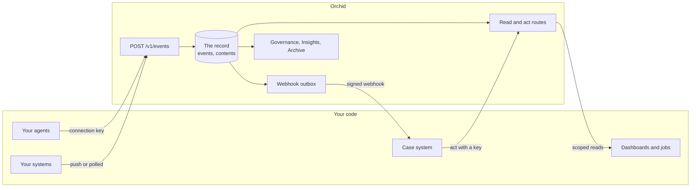

Orchid records everything that happens with AI at your firm: conversations in Claude, ChatGPT and Orchid itself, model calls, what the AI read in your systems, and, where your firm records them, email, chat, meetings and files. Governance runs your rules on that record, and Insights turns it into cost, savings and time saved.

The developer API lets your own code take part. It does three things.

<CardGroup cols={3}>
  <Card title="Send" icon="arrow-up-from-bracket" href="/send/events">
    Your agents' runs, the systems they touch and anything else your firm defines go into the same record, under the same rules.
  </Card>
  <Card title="Read" icon="magnifying-glass" href="/read/record">
    The record, your agents' figures, and what AI cost and saved, with the same numbers the console shows.
  </Card>
  <Card title="Act" icon="bolt" href="/act/webhooks">
    Hear about events as they happen, then work alerts, move insight actions or start AI employee runs.
  </Card>
</CardGroup>

## How it fits together

Everything goes through one record, kept where the rest of your firm's records are: on Orchid's cloud, or in your own database on a firm VM or on premises. Governance, Insights and the archive read your events without any code written for them.

## Start here

<Steps>
  <Step title="Make a connection and a key">
    An admin adds a connection under **Admin › Developers** and makes a key with the scopes it needs. See [Keys and scopes](/getting-started/keys-and-scopes).
  </Step>
  <Step title="Send your first event">
    Define an event type and send a batch. See the [Quickstart](/getting-started/quickstart).
  </Step>
  <Step title="Read it back and subscribe">
    List what you sent, read your [cost and savings](/read/cost), and subscribe a URL with [webhooks](/act/webhooks).
  </Step>
</Steps>

<Note>
  The developer API never sends, edits or deletes email, chat messages or calendar items. Acting means changing Orchid's own state: alerts, insight actions and AI employee runs.
</Note>
